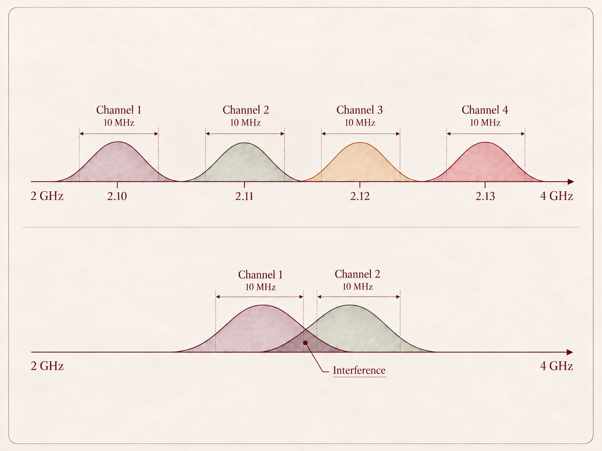

SpaceX began October with the acquisition of Grain Management's nationwide portfolio of 800MHz low-band spectrum licenses.

This bolsters SpaceX's EchoStar which acquired 2 GHz spectrum for S-band communications. The lower-frequency spectrum from Grain further expands SpaceX's vertical stack and could help position the company as a full-fledged mobile carrier competing with Verizon and AT&T, rather than simply providing satellite connectivity when terrestrial cell service is unavailable. Together they are building a real hybrid cellular network, paying bullion essentially for the legal right to transmit over a particularly useful slice of frequencies nationwide.

To understand why this matters, it helps to first understand spectrum itself: what it is to how different frequencies behave and why owning the right bands can be so strategically valuable.

Spectrum is the range of invisible radio waves we use to send information. Phones, Wi-Fi, GPS, satellites, Bluetooth, etc. all communicate using waves. Frequency just distinguishes one wave from another. The FCC is the primary governing body that divides spectrum into bands because two systems using the same frequency can interfere with each other. The full allocation is quite granular, however a high level breakdown looks something like this:

- FM radio: 88-108 MHz
- Cellular: spread across many bands, from roughly 600 MHz into the several-GHz range
- GPS: primarily around 1.2-1.6 GHz
- Wi-Fi: primarily 2.4 GHz, 5 GHz, and 6 GHz
- Satellite / space communications: use numerous bands, including portions of S-band
  - S-band: generally ~4 GHz, although actual permitted uses depend on the specific slice of spectrum

Lower frequencies generally travel farther and penetrate walls and other obstacles better. Higher frequencies can often support more data, but they have shorter range and are more easily blocked. And technically we have an "infinite" spectrum (... not really).

Take S-band as defined between 2 to 4 GHz, within that range there are an infinite number of possible exact frequencies such as 2.100000 GHz, 2.100001 GHz, 2.100002 GHz, and so on. But you cannot pack infinite communications channels into it, because every real signal takes up some width around its center frequency. For example, if one satellite link uses a 10 MHz-wide channel, it is not using just one mathematical point. It occupies a chunk of the spectrum. Put another signal too close to it and they start interfering.

  

This is why the Grain Management acquisition is huge. By acquiring licensed pieces of spectrum, SpaceX is buying control over a scarce block of usable bandwidth that can expand its network capacity. To show just how valuable spectrum rights are, the FCC's 2021 auction of only 100 MHz of 3.45-3.55 GHz spectrum generated \$22.5 billion in gross proceeds. The FCC is maintaining a pipeline of additional mid-band spectrum is critical as mobile networks move toward 6G, particularly given growing AI and machine-to-machine communications demand.

Spectrum scarcity creates value in two places: owning the spectrum, and figuring out how to squeeze more out of it. SpaceX is pursuing the first, Qualcomm became one of the most important wireless companies in the world by mastering the second. The foundation for Qualcomm's CDMA-based cellular networks, and eventually much of 3G, was the spread-spectrum technology Qualcomm commercialized at scale. It differed from earlier approaches such as FDMA, which separated users by giving each one a different frequency channel, and TDMA, which let users share a frequency by taking turns in different time slots. CDMA instead spread signals across a wider block of spectrum and separated users by code.

The next layer on top of spectrum scarcity is visibility and control. As more systems compete for the same airwaves, simply owning or efficiently using spectrum is not enough; operators also need to understand what is happening across it in real time. At Everywhere, this is why we are excited about what Carrie and the Rebel Space team are building: infrastructure to monitor, understand, and ultimately help manage the RF environment as it becomes more congested and strategically important.

Rebel is already pushing this intelligence layer into orbit. In [August](https://rebelspacetech.com/post/rebel-space-portal-space-systems-announce-partnership), the team announced a partnership with Portal Space Systems to bring spectrum monitoring and electronic-threat detection onboard spacecraft, giving operators real-time visibility into interference and other RF activity around them.

Since the pioneering work of Maxwell, Hertz, and Marconi in the late 1800s, spectrum has evolved from invisible infrastructure into strategic infrastructure. Connectivity will only continue to expand across satellites and autonomous systems making access to usable spectrum increasingly valuable. The winners will not just be the companies that build the networks, but those that secure it, and make them intelligible in real time.

