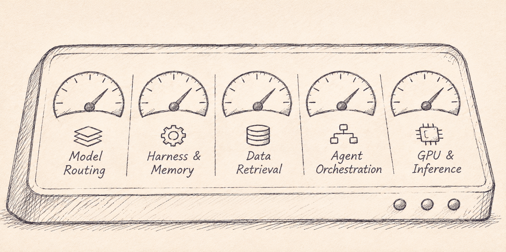

Everyone talks about optimizing models, inference costs, memory, and output, but some steps of the full stack aren’t always as obvious or necessarily controllable for the user. The cheapest model, as we know, isn’t necessarily the most efficient, and the best output isn’t necessarily the most valuable, depending on how you get there. To be truly ‘optimized,’ you have to consider the entire system, from the application and harness down to GPU utilization and data center infrastructure.

  

---

**1:: Model Selection and Routing**

Model selection is one of the obvious and controllable first layers of AI optimization, but choosing the cheapest or most powerful model does not necessarily produce the most efficient outcome. The crux of the matter is which model or combinations can complete a specific task at the lowest cost without compromising accuracy, latency or reliability. Menlo’s state of AI highlighted that frontier models now account for *63%* of enterprise AI spend, up from *35%* a year earlier, even as cheaper alternatives become increasingly capable. Meanwhile, open source models account for *19%* of token usage however, *4%* of spending. This can be equated to open source being on a path to dominate usage; however, dollars are flowing to foundation models (average token prices of *\$0.13* per million compared with *\$0.70* for closed models).

Enterprises continue paying a premium for intelligence even as lower-cost alternatives become viable for growing numbers of tasks. The opportunity lies in intelligently routing requisitions across models bespoke to a company’s use case rather than relying on a single model for every workflow. OpenAI demonstrated this point in a Sept 2026 optimization exercise where **combining model routing, prompt optimization, caching, and workflow restructuring** could reduce the simulated cost of *100,000* customer support tickets from *\$3,813 to \$204, a 94.6%* reduction while improving measured quality… This is the type of “AI engineering” that non-technical employees can learn. Ultimately, the goal should not be to minimize cost per token, but to optimize cost per successfully completed task, dynamically allocating intelligence where it creates the greatest value. In today’s market, the analogy is getting the best talent at the best price. With AI, however, <u>everyone has access to the best talent; the advantage now lies in knowing how to extract the most value from it.</u>

***COMPANY SHOUTOUT → LiteLLM raised a \$1.6M seed round from Y Combinator, Gravity Fund, and Pioneer Fund. SF-based, it’s an open-source LLM Gateway and a single SDK and FastAPI server that lets teams call 100+ LLM APIs (Bedrock, Azure, OpenAI, VertexAI, Cohere, Anthropic) in one unified OpenAI-compatible format, so switching or routing between model providers doesn’t mean rewriting integration code for each one. \*Unlike OpenRouter and other hosted gateways, LiteLLM is open-source and self-hostable; thus, teams run it on their own infrastructure with their own API keys, so traffic never passes through a third-party server, avoiding the added latency, markup, and vendor lock-in of a hosted proxy.***

---

**2:: Harness Context and Memory**

Selecting the right model is phase 1. How the model is configured and what information it can access are equally important to performance. Having a malleable and specific agent harness (the software layer responsible for orchestrating tools, managing context, maintaining memory, and executing workflows is critical. Thomas Tunguz from Theory Ventures used UC Berkeley’s research as a compelling illustration of this point. Harness optimization reduced costs by *71%* for the same successfully completed software engineering task without a statistically significant difference in quality. The harness can also dramatically influence performance; GPT-5.5 achieved *61.5%* in OpenAI’s Codex versus *87.2%* in Cursor. Context management creates another substantial efficiency opportunity, particularly as input tokens account for *85.7%-98.2%* of token volume across the workloads. In Sept., OpenAI introduced competitive caching improvements and offered discounts of up to *90%* of reused input tokens, with a customer reporting a *36%* reduction in inference costs after improving cache utilization. LangChain reduced its agent harness’s base input token usage by *65%* while maintaining quality of output.

Beyond managing context, memory introduces an opportunity for agents to improve across sessions. I believe for memory there are really two schools of thought: 1) markdown files and 2) continuous learning with some sort of slow/fast loop and rewarding agents. Since, as cited earlier, frontier models occupy *65%* of enterprise AI spend, the former is most relevant here (... maybe not for long). Anthropic found that adding persistent memory improved Claude Opus 5.5’s benchmark score from *65.5% to 83.8%*, while structured knowledge representations improved performance on complex document questions from *73% to 87%*.

***COMPANY SHOUTOUT → LangChain raised a \$125M Series B in October 2025, led by IVP, at a \$1.25B valuation. SF-based, it builds the agent engineering platform and open-source frameworks (LangGraph and LangChain) that developers use to ship reliable agents. LangSmith adds observability and evals. That gives teams one configurable harness for orchestration, context, and memory, so they don’t have to stitch the pieces together by hand. The company has also cut its own agent harness’s base input tokens by 65% with no loss in output quality.***

---

**3:: Vectorization, Data Retrieval and Quality of Data**

Quality of data is really the under-the-hood engine that will support the latter two points. Even with the right model and harness, an AI system is only as effective as the information it can access. Enterprises are increasingly using some form of RAG to connect models to property data, but simply vectorizing information into embeddings does not guarantee accurate retrieval. The quality of the underlying data, how it is structured and chunked, and how relevant information is retrieved all directly affect performance. MongoDB reported that adding native reranking improved retrieval quality by up to *30%*, demonstrating the value of refining search results before passing them to a model. Their newer lightweight reranking model could match the retrieval quality of its previous model at *40%* of the price. Similarly, Databricks introduced adaptive retrieval capable of delivering search quality with *2x* lower latency.

***COMPANY SHOUTOUT → Antfly raised a \$2M pre-seed in September 2026, led by Heavybit with participation from 8-Bit Capital. SF-based, builds a retrieval engine purpose-built for AI agents by automating the chunking, embedding, and search steps that most RAG pipelines bolt together ad hoc, so agents get higher-quality retrieved context without teams hand-tuning their vector pipeline.***

---

**4:: Agent Orchestration and Output Efficiency**

Agent orchestration determines whether tasks are handled sequentially, delegated to specialized agents, or executed in parallel, introducing tradeoffs between output quality, latency, and computational cost. This is not a new idea by any means; in 2025, Anthropic found that multiple agent architectures consume approximately *15x* more tokens than traditional chat interactions, compared with *4x* for single-agent workflows. However, its multi-agent research system outperformed a single-agent baseline by *90.2%* on an internal evaluation, while parallelizing agents and tool calls reduced research time by as much as 90% on complex queries. Via OpenRouter, token consumption has increased *14x* compared with *2x* growth in human usage. Yet more computation does not automatically translate into more valuable output. LangChain published research that described a shift towards <u>asynchronous orchestration</u>. Where agents can delegate long-running tasks without blocking other work; ultimately, the objective is not to maximize the number of agents, tool calls, or tokens consumed, but to maximize the value, a successful successfully completed work relative to the time, compute, and human in the loop required to produce it.

***COMPANY SHOUTOUT → Replicas \$4M Seed in October. A cloud coding agent that lets you delegate tasks to Claude Code or Codex from the app, Slack, or Linear; each task runs in its own sandbox.***

---

**5:: GPU Memory, Inference, and Rack-Level Optimization**

Optimization does not end at the application layer by any means; it extends all the way down to GPU memory, utilization, inference engines, network, and even the physical infrastructure supporting compute (the ladder may be out of the user’s hands in some cases). As workloads become increasingly agentic, the bottleneck is no longer simply how much compute you can deliver, but how efficiently systems manage memory, reuse cached information, distribute workloads, and generate tokens within latency and power constraints. Nvidia has highlighted how GPU high-bandwidth memory is consumed by model weights, KV caches, and redundant computation, reporting that its next-generation Vera Rubin NVL72 platform could deliver up to *30×* more agentic inference throughput per megawatt than GB300 NVL72 on SemiAnalysis benchmarks.

Optimization of its TensorRT LOM and Dyamo software stack reduced B200 inference cost from *\$.11 to \$.02* per million tokens, approximately a *5x* improvement without changing hardware, indicating these gains come not just from hardware components. Semi analysis also demonstrated why traditional GPU benchmarks increasingly fail to capture real-world inference efficiency, examining identity workflows with context length exceeding 1 million tokens. There are a myriad of other segments of the stack that can be addressed, whether it’s cooling systems or efficient rack assembly; however, starting with the controllable will help organizations onboard AI most effectively.

***COMPANY SHOUTOUT → Isoquant enables price discovery for compute, helping companies identify the best hardware for their workloads and run it with an optimized inference stack. Directly addresses GPU selection and inference efficiency.***

---

---

  
1. <a href="https://menlovc.com/perspective/2026-the-state-of-enterprise-ai/">Menlo Ventures' November 2026 State of Enterprise AI</a>

  
2. <a href="https://www.michaeljbarone.com/ideas/beyond-the-token">Beyond the Token</a>

  
3. <a href="https://developers.openai.com/cookbook/examples/agent_optimization/optimizing_agents_for_cost_and_quality">Optimizing Customer Support Agents for Cost and Quality</a>

  
4. <a href="https://tomtunguz.com/the-four-questions-of-ai/">The Four Questions of AI</a>

  
5. <a href="https://www.anthropic.com/research/components-of-agent-memory">The components of agent memory</a>

  
6. <a href="https://www.mongodb.com/company/newsroom/press-releases/mongodb-delivers-accurate-ai-retrieval-wherever-enterprise-data-lives">MongoDB Delivers Accurate AI Retrieval Wherever Enterprise Data Lives</a>

  
7. <a href="https://www.databricks.com/blog/adaptive-instructed-retriever-frontier-quality-search-2x-lower-latency">Adaptive Instructed-Retriever: Frontier-Quality Search at 2x Lower Latency</a>

  
8. <a href="https://www.anthropic.com/research/multi-agent-research-system">How we built our multi-agent research system</a>

  
9. <a href="https://www.langchain.com/blog/agents-are-going-async">Agents Are Going Async</a>

  
10. <a href="https://developer.nvidia.com/blog/five-ways-nvidia-co-design-maximizes-the-value-of-every-byte-in-the-ai-factory/">Five Ways NVIDIA Co-Design Maximizes the Value of Every Byte in the AI Factory</a>

  
11. <a href="https://newsletter.semianalysis.com/p/vera-rubin-nvl72-agentic-inference">Vera Rubin NVL72 Agentic Inference: 67x better Performance per Dollar</a>

